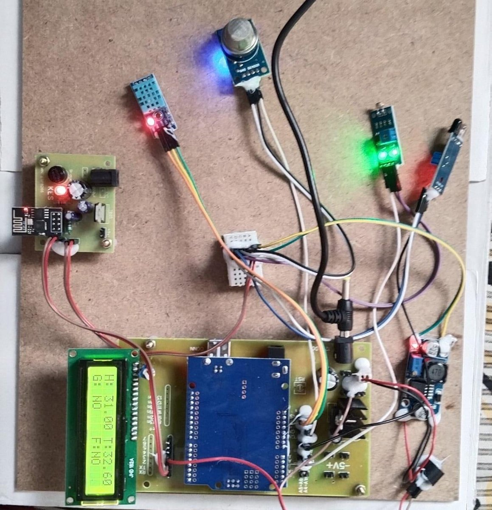
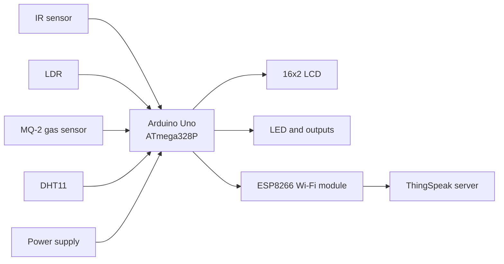
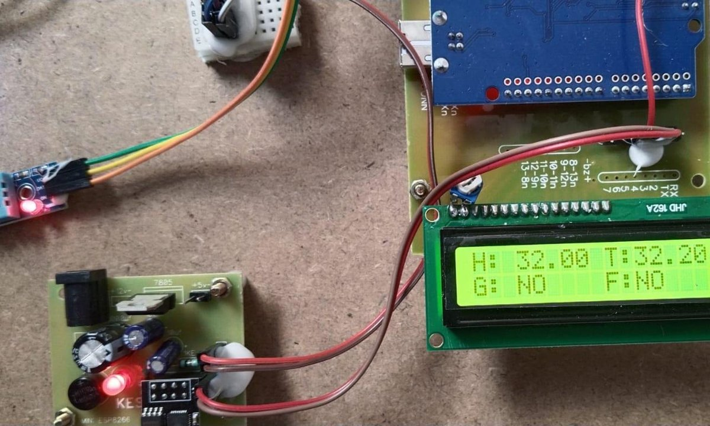
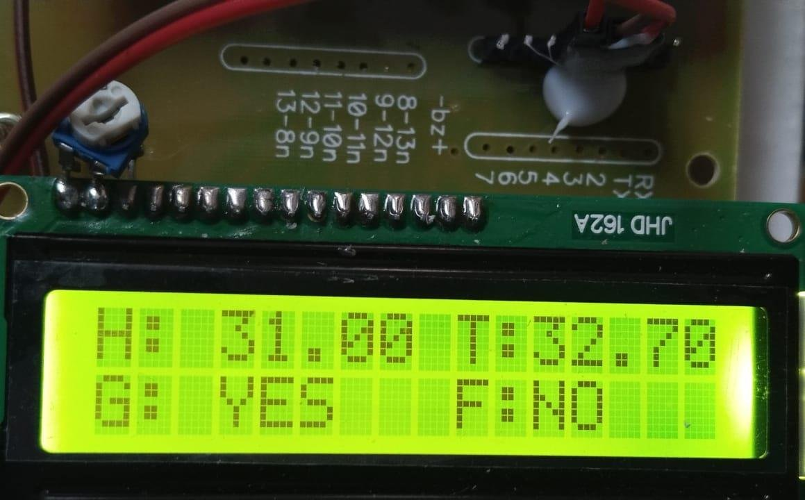
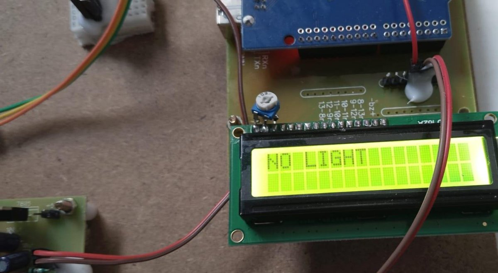
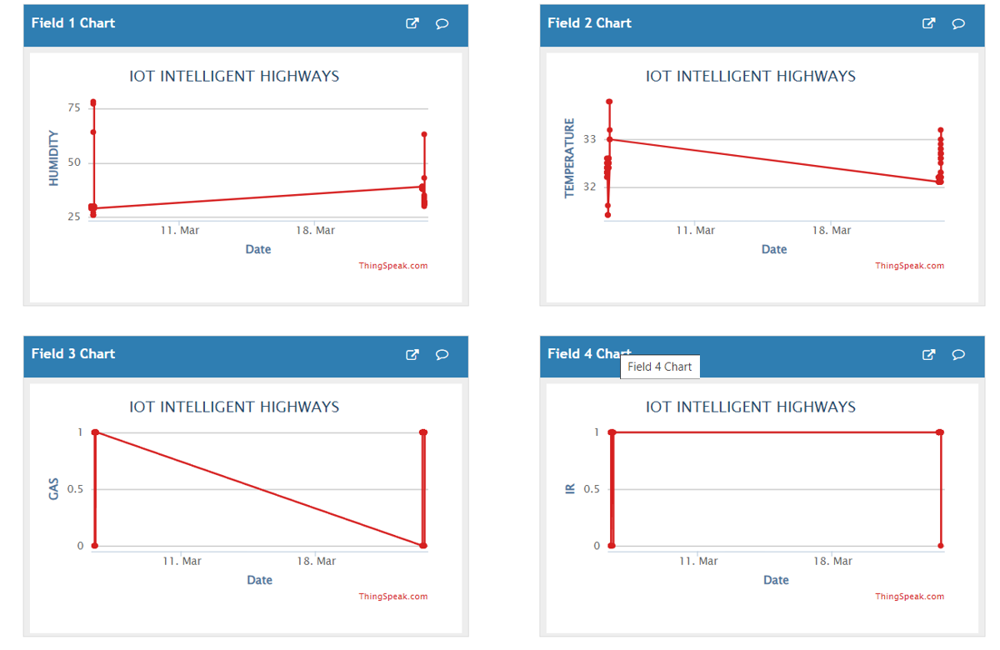

# Integrated Sensor Network for Vehicle Environment Detection

An Arduino Uno based IoT prototype that monitors the environment around a vehicle. Four sensors measure temperature and humidity, harmful gases, nearby objects and ambient light. The readings are shown on a 16x2 LCD, trigger local alerts, and are uploaded over Wi-Fi to a ThingSpeak channel for remote monitoring.

This was a final-year B.Tech project in Electronics and Communication Engineering at Sreenidhi Institute of Science and Technology, Hyderabad. It is a **team project**, see [Team and credits](#team-and-credits).



## What the system does

| Sensor | Measures | Used for |
|---|---|---|
| DHT11 | Temperature and humidity | Weather and cabin-condition alerts (high humidity, high temperature) |
| MQ-2 gas sensor | Combustible and harmful gases (for example carbon monoxide, methane) | Gas warning |
| IR sensor | Nearby object or vehicle | Obstacle / vehicle detection warning |
| LDR | Ambient light | "No light" warning and switching on a car-light output |

The Arduino reads the sensors, compares them with thresholds, shows the values on the LCD, switches an LED and two outputs, and sends the five values to ThingSpeak.

## Block diagram



## How the firmware works

Each cycle the Arduino:

1. Reads humidity and temperature from the DHT11 and the three digital sensor outputs (gas, IR, LDR).
2. Switches the car-light output when there is no light, and the IR output when something is detected.
3. Shows humidity, temperature and the gas and IR flags on the LCD.
4. Checks the alert conditions below and shows a message with the alert LED.
5. Uploads the values to ThingSpeak, then waits before the next cycle.

| Condition | LCD message | Other action |
|---|---|---|
| Humidity above 80 % | `HUMIDITY HIGH` | Alert LED |
| Temperature above 40 °C | `TEMP HIGH` | Alert LED |
| Gas sensor output LOW | `GAS DETECT` | Alert LED, `G: YES` |
| IR sensor output LOW | `IR DETECT` | Alert LED, IR output on, `F: YES` |
| LDR output HIGH (dark) | `NO LIGHT` | Alert LED, car-light output on |

ThingSpeak fields: 1 humidity, 2 temperature, 3 gas, 4 IR, 5 LDR.

## Results

The photos and charts below come from the working prototype and its ThingSpeak channel.

| LCD during normal operation | Gas detected |
|---|---|
|  |  |

| No light detected | ThingSpeak channel charts |
|---|---|
|  |  |

Example observations from the prototype: humidity 31.00 % and temperature 32.70 °C with gas detected (`G: YES`), and humidity 32.00 % and temperature 32.20 °C with no alerts.

## Repository contents

```
firmware/vehicle_env_detection/
    vehicle_env_detection.ino    Arduino sketch
    secrets.h.example            template for Wi-Fi and ThingSpeak credentials
docs/images/                     prototype photos and ThingSpeak charts
```

## Build and run

Hardware: Arduino Uno, DHT11, MQ-2 gas sensor module, IR sensor module, LDR module, 16x2 LCD, ESP8266 Wi-Fi module, 5 V regulated supply.

1. Install the Arduino IDE and the **DHT sensor library** (Adafruit).
2. Copy `firmware/vehicle_env_detection/secrets.h.example` to `secrets.h` in the same folder and enter your own Wi-Fi name, password and ThingSpeak write API key. Do not commit `secrets.h`.
3. Open `vehicle_env_detection.ino` and set `GAS_PIN`, `IR_PIN` and `LDR_PIN` to match your wiring.
4. Upload the sketch to the Arduino Uno.

Pins fixed in the sketch: LCD on 13, 12, 11, 10, 9, 8 (RS, EN, D4 to D7); ESP8266 on 2 (RX) and 3 (TX); DHT11 on A0; alert LED on 4; outputs on 5, 6 and 7.

## Notes and limitations

- The sketch in this repository is a cleaned-up version of the code listing printed in the project report. The original listing had broken formatting and missing lines, so the Wi-Fi connection and upload functions were rewritten in the usual ESP8266 AT-command style, and the three input pins are left for you to set.
- The upload interval is 15 seconds, because free ThingSpeak accounts accept one update per 15 seconds.
- The alert LED waits 1.5 seconds per alert, so one cycle with several alerts takes longer.
- The prototype is a demonstration. The sensors are not calibrated, and the thresholds are fixed values, not measured limits.

## Future scope

- Data analysis and machine learning on the collected sensor history to predict congestion, weather hazards or air-quality problems
- More sensors, for example road-surface condition, and cameras for road signs and pedestrians
- Vehicle-to-vehicle and vehicle-to-infrastructure communication
- A mobile app with route and weather alerts

## Team and credits

Team project at the Department of Electronics and Communication Engineering, Sreenidhi Institute of Science and Technology (SNIST), Hyderabad, under the guidance of Dr. B. Krishnaveni, Assistant Professor.


- K. Srinath Reddy ([@srinath-kothakapu](https://github.com/srinath-kothakapu)): schematic design, prototype build-up, firmware integration, testing and documentation

The team also wrote the paper "Integrated Sensor Network for Vehicle Environment Detection" about this system.
